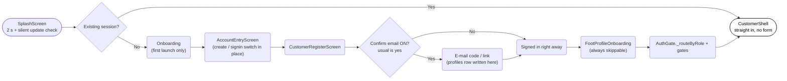
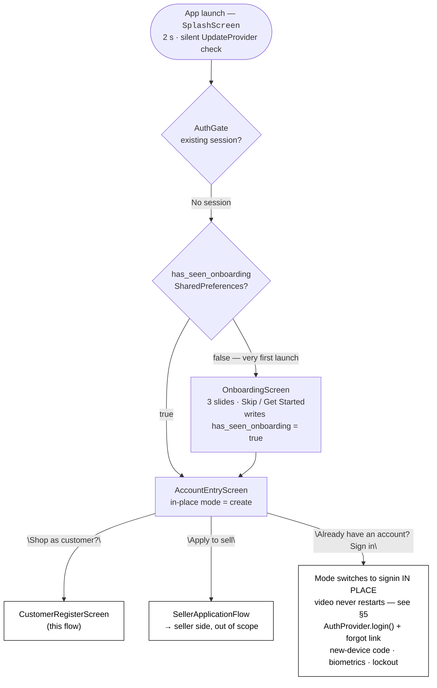
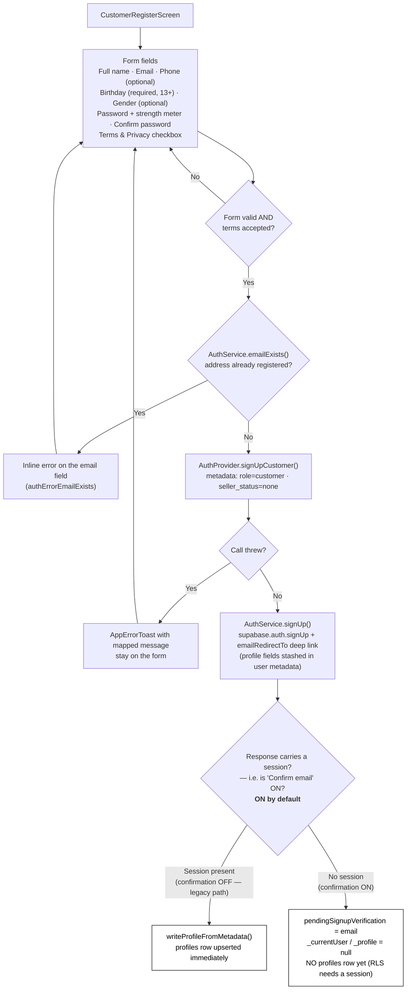
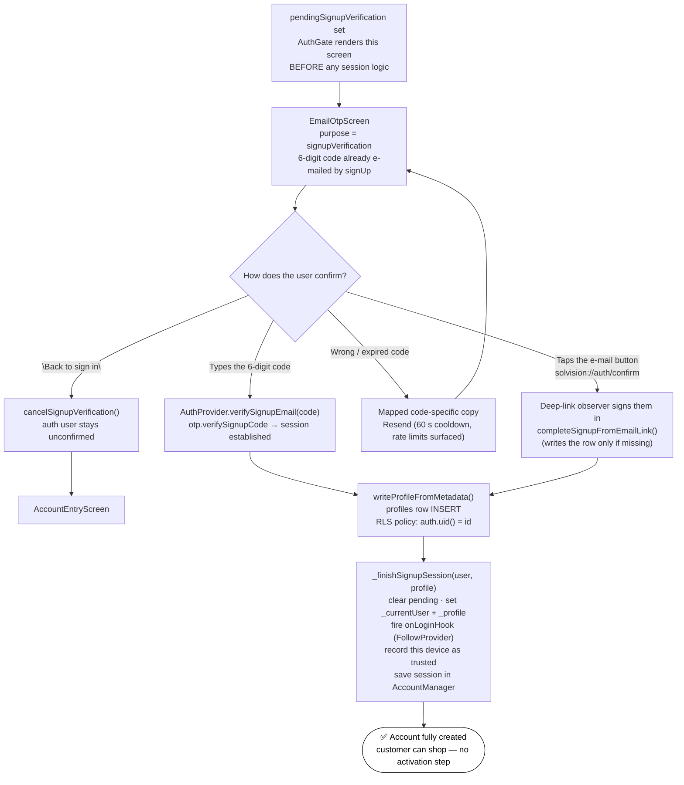
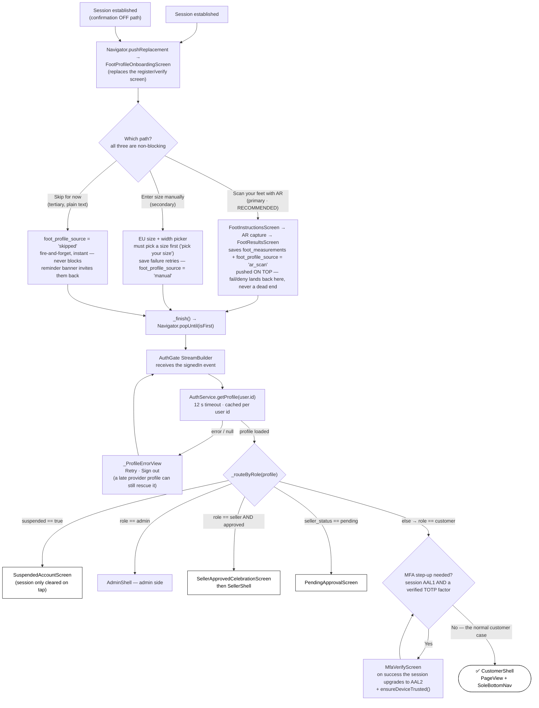
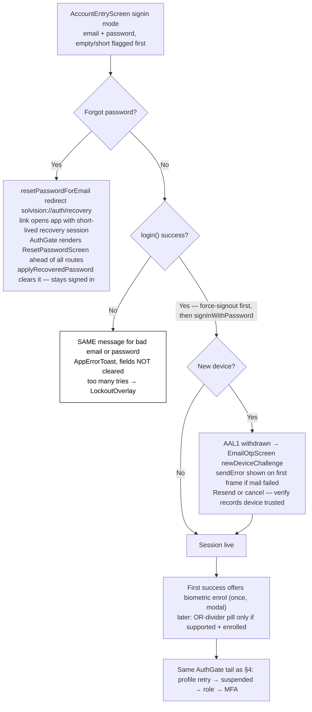
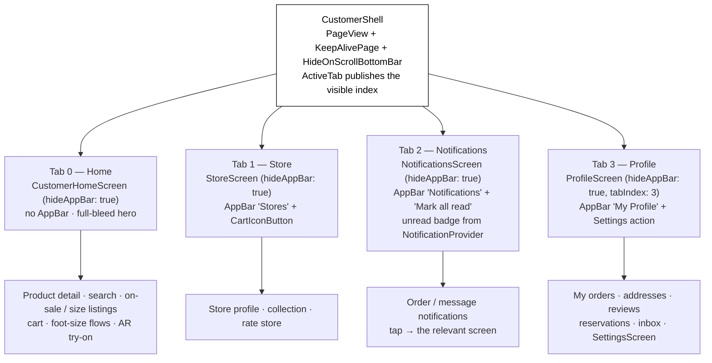

# Customer Sign-Up Flow — Quick Reference Graph

> **Purpose:** One diagram for the whole customer path — from app launch / sign-up to landing inside `CustomerShell` (Home · Store · Notifications · Profile).
> **Audience:** AI agents and developers tracing or changing the customer auth entry point.
> **Last updated:** October 17, 2026 — polished to the actual journey: splash shortcut, confirm-OFF branch, give-up path, foot-scan returns, full sign-in gates
> **Verified against:** `lib/screens/auth_gate.dart`, `lib/screens/auth/customer_register_screen.dart`, `lib/screens/auth/account_entry_screen.dart`, `lib/screens/auth/foot_profile_onboarding_screen.dart`, `lib/providers/auth_provider.dart`, `lib/services/auth_service.dart`, `lib/screens/customer/customer_shell.dart`
>
> **Editable copy (Dia):** `docs/AI/diagrams/customer-signup-flow.dia` — the same flow as an editable [Dia](https://gitlab.gnome.org/GNOME/dia) diagram. It has two layers, "1 - Signup to CustomerShell" and "2 - CustomerShell tabs", which can be toggled independently in the Layers dialog. Rendered exports sit beside it (`.png`, `.svg`).
>
> **Client-facing copy (draw.io):** `docs/diagrams/customer-signup-flow.drawio` — the same journey written in plain English for the customer, with no screen, class or table names. The `customer-signup-flow-preview.png` and `.svg` beside it are previews drawn from the same coordinates. The whole customer journey (sign-up, shopping, try-on, custom pairs, orders, messages, profile) is the 13-page `docs/diagrams/customer-journey-flowchart.drawio`, with page previews in `docs/diagrams/previews/` — see `docs/diagrams/README.md`.

## Table of Contents
1. [The one-line version](#1-the-one-line-version)
2. [Stage 1 — Launch to the registration form](#2-stage-1--launch-to-the-registration-form)
3. [Stage 2 — Account creation and e-mail confirmation](#3-stage-2--account-creation-and-e-mail-confirmation)
4. [Stage 3 — Foot-profile step, then AuthGate routing into the shell](#4-stage-3--foot-profile-step-then-authgate-routing-into-the-shell)
5. [Returning-user sign-in — the gates a new customer skips](#5-returning-user-sign-in--the-gates-a-new-customer-skips)
6. [Stage 4 — CustomerShell: the four tabs](#6-stage-4--customershell-the-four-tabs)
7. [Decision points worth knowing](#7-decision-points-worth-knowing)
8. [File map](#8-file-map)
9. [Not covered here](#9-not-covered-here)

---

## 1. The one-line version

> ⚠️ The customer has **no navigation of its own** on success. Every screen in the
> sign-up path stops at "account created" and `AuthGate`'s `StreamBuilder` swaps
> the root widget. Pushing a route from inside the gate's subtree replaces the
> gate's own route and kills the auth listener — see the comment in
> `lib/screens/auth/onboarding_screen.dart`.

---

## 2. Stage 1 — Launch to the registration form

> `AccountEntryScreen` is **one screen with two modes**, not two routes. `create`
> (default) is the customer / seller choice; `signin` is the same widget with the
> form. Both buttons in create mode DO push routes; the sign-in switch does not.

---

## 3. Stage 2 — Account creation and e-mail confirmation

### 3.1 The confirmation gate (only reached when there is no session yet)

> The `profiles` row is **not** written by an `on auth.users` trigger — that is
> exactly why confirmation is deferred to this point. Either the code or the
> e-mail link supplies the session the row's INSERT policy requires.

---

## 4. Stage 3 — Foot-profile step, then AuthGate routing into the shell

> A **brand-new** customer signup normally skips every gate here: no MFA factor is
> enrolled yet, the device was recorded as trusted during `_finishSignupSession`,
> and `role = 'customer'` falls through to the final `else`.

---

## 5. Returning-user sign-in — the gates a new customer skips

> Password login never reveals whether the e-mail exists (`invalid_credentials`
> and `user_not_found` share one message). `login()` resets
> `_currentUser`/`_profile` first so a retry never flashes the old account.

---

## 6. Stage 4 — CustomerShell: the four tabs

> Labels are `Home`, `Store`, `Notifications`, `Profile` for `roleCustomer` in
> `lib/widgets/sole_bottom_nav.dart`. Each visited tab stays mounted
> (`KeepAlivePage`) — `initState` does not re-run when switching back.

---

## 7. Decision points worth knowing

| # | Decision | Where | What happens |
|---|---|---|---|
| 0 | Existing session? | `AuthGate` + `SplashScreen` update check | Session present → profile fetch → shell directly, no form |
| 1 | Onboarding seen? | `_FirstTimeOrLoginRouter` (auth_gate.dart) | 3-slide intro once per install; written to `has_seen_onboarding` |
| 2 | Create vs. sign in | `AccountEntryScreen._switchMode` | In-place state change, **not** a route push (the video hero never restarts) |
| 3 | Email already registered? | `AuthService.emailExists()` before signUp | Inline field error, no account created, no e-mail sent |
| 4 | Terms accepted? | `CustomerRegisterScreen._submit` | Blocks submit with a toast (independent of form validation) |
| 5 | "Confirm email" ON? | `AuthService.signUp` → `response.session == null` | Yes (default) → OTP screen owns the hand-off; No → immediate profile write + auto-login |
| 6 | Code vs. e-mail link | `EmailOtpScreen` / `DeepLinkService.isAuthConfirmLink` | Both end at `writeProfileFromMetadata()`; the link path is the cold-start race the provider profile watcher exists for |
| 7 | Foot profile path | `FootProfileOnboardingScreen` | AR scan (fail returns here) / manual (must pick size) / skip (instant) — all land in the shell |
| 7b | Give up on the code? | `cancelSignupVerification()` | Back to sign in; auth user stays unconfirmed, asked again next time |
| 7c | Forgot password? | `resetPasswordForEmail` → `ResetPasswordScreen` | Recovery session first, shell only after new password |
| 7d | Same-error rule? | `friendlyAuthErrorMessage` | Bad email and bad password read identically; fields kept |
| 7e | Lockout? | `pendingLockout` → `LockoutOverlay` | Too many tries locks the screen for a while |
| 7f | New device? | `pendingDeviceChallenge` | Code mailed; sendError shown on the OTP first frame, not silent |
| 7g | Biometrics? | `BiometricService` + secure vault | Pill only if supported + enrolled; offered once after first success; logout clears vault, keeps declined flag |
| 8 | Profile fetch failed? | `AuthGate` `FutureBuilder` | Retry screen with a Sign-out escape hatch; a late profile from `AuthProvider` short-circuits it |
| 9 | Role / status routing | `AuthGate._routeByRole` | admin → AdminShell · approved seller → SellerShell · pending → PendingApprovalScreen · **else → CustomerShell** |
| 10 | MFA step-up | `_MfaGate` | Only for AAL1 + verified TOTP factor; a new customer has neither |

---

## 8. File map

| Stage | File |
|---|---|
| Splash + silent update check | `lib/screens/auth/splash_screen.dart` |
| Auth decision tree, OTP gates, role routing, error view | `lib/screens/auth_gate.dart` |
| First-launch onboarding | `lib/screens/auth/onboarding_screen.dart` |
| Merged create / sign-in front door | `lib/screens/auth/account_entry_screen.dart` |
| Customer registration form | `lib/screens/auth/customer_register_screen.dart` |
| 6-digit e-mail code screen (signup + new device) | `lib/screens/shared/email_otp_screen.dart` |
| Post-signup foot-profile step | `lib/screens/auth/foot_profile_onboarding_screen.dart` |
| State: signUpCustomer / verifySignupEmail / _finishSignupSession | `lib/providers/auth_provider.dart` |
| State: routing, device trust, lockout, MFA | `lib/providers/auth_provider.dart`, `lib/services/mfa_service.dart` |
| Supabase signUp + profiles write | `lib/services/auth_service.dart` |
| The 4-tab shell | `lib/screens/customer/customer_shell.dart` |
| Tab bar labels/icons | `lib/widgets/sole_bottom_nav.dart` |

---

## 9. Not covered here

- **Returning-user sign-in internals** — see §5 above plus
  `docs/AI/EMAIL_OTP_AND_DEVICE_TRUST_ARCHITECTURE.md` and
  `docs/AI/SIGN_IN_ARCHITECTURE.md` (biometric vault, DismissOnSignIn, AnimatedSwitcher fade).
- **Seller application** — `lib/screens/auth/seller_application_flow.dart` and
  `docs/AI/SELLER_ARCHITECTURE_GRAPH.md`.
- **Admin side**, and everything past the four tabs (cart → checkout → order).

> ⚠️ `docs/SIGNUP_ARCHITECTURE.md` predates the split registration screens: it
> still describes a single `AuthProvider.signUp(..., applyAsSeller:)` form and a
> success SnackBar. The current code is `signUpCustomer` + the separate seller
> flow, and the register screen hands off to `FootProfileOnboardingScreen`
> instead of showing a SnackBar.
